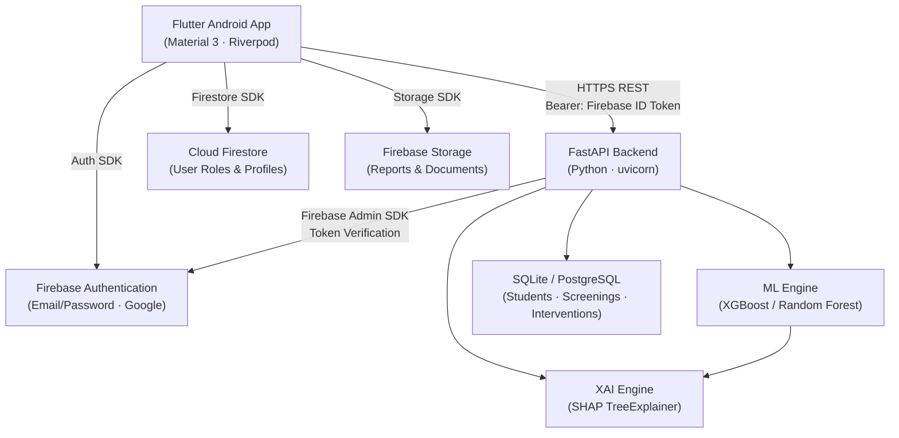
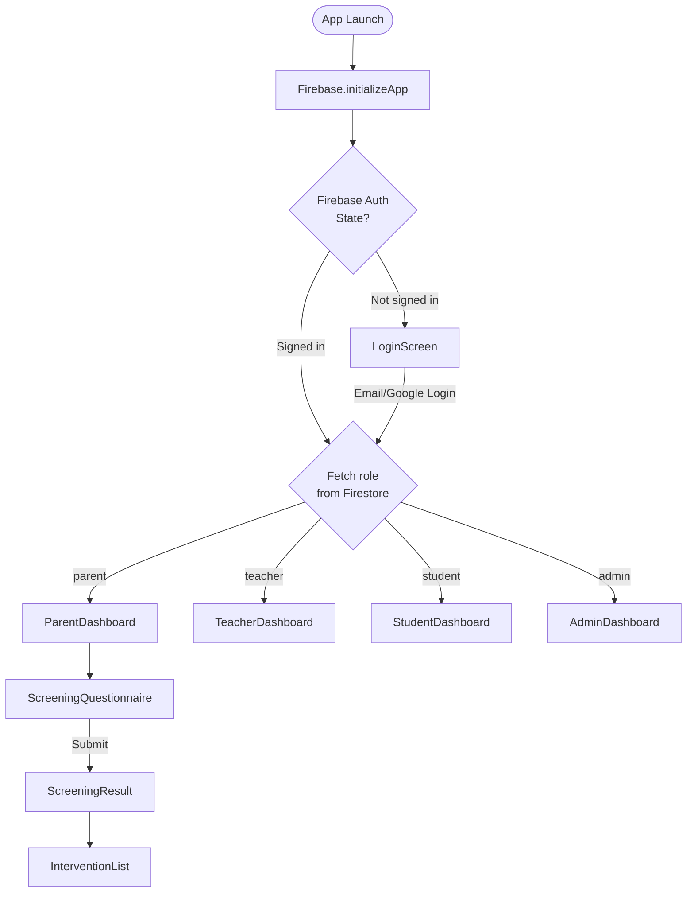
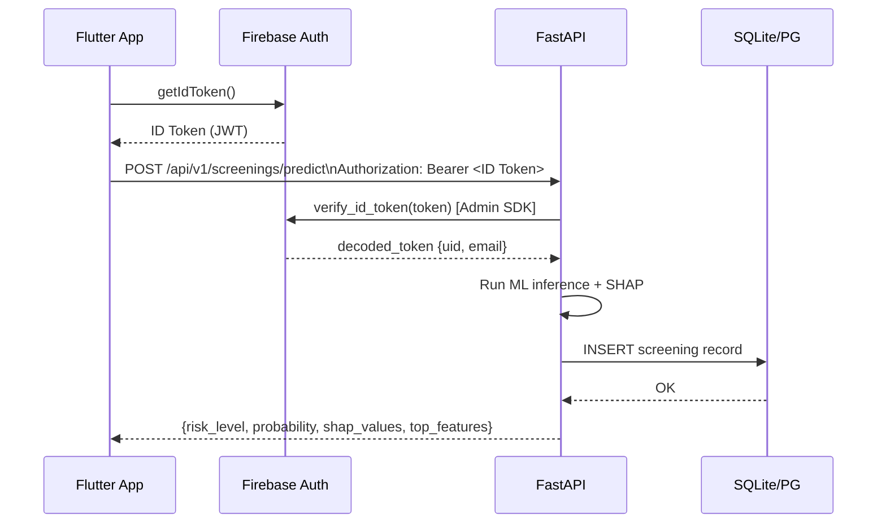
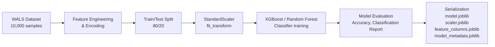
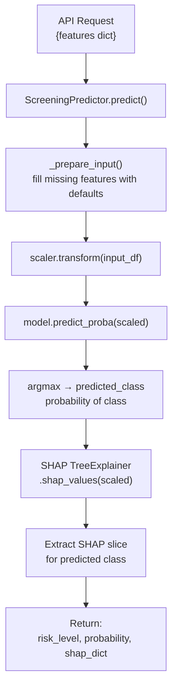
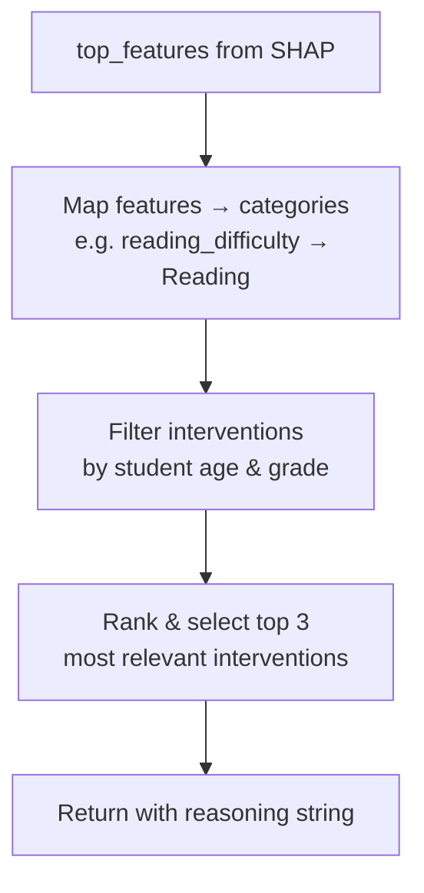
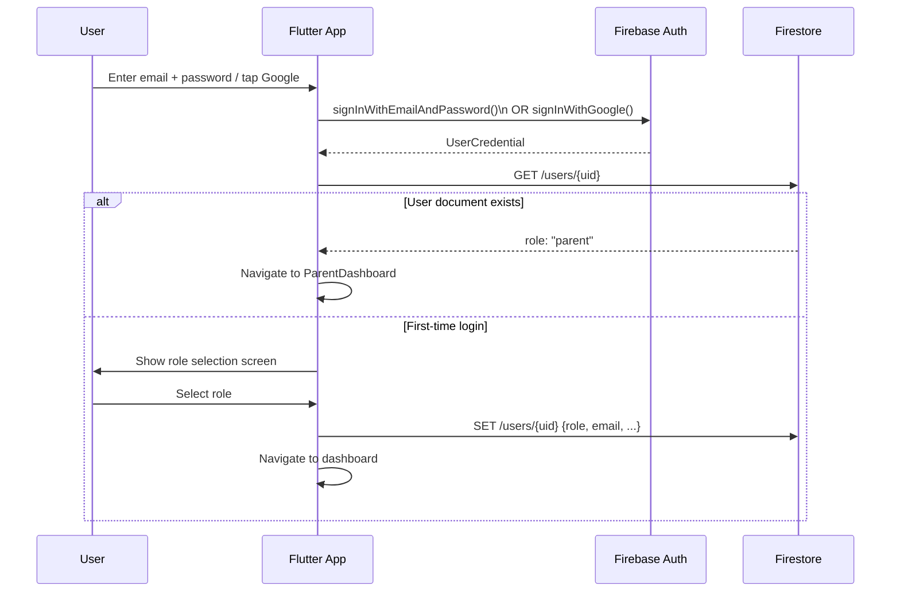
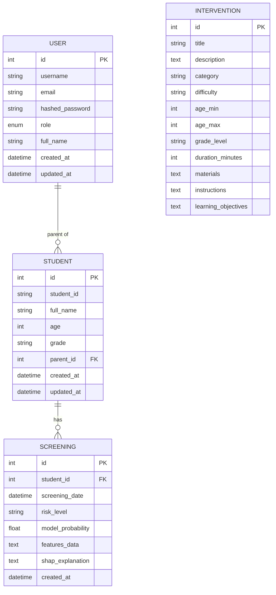
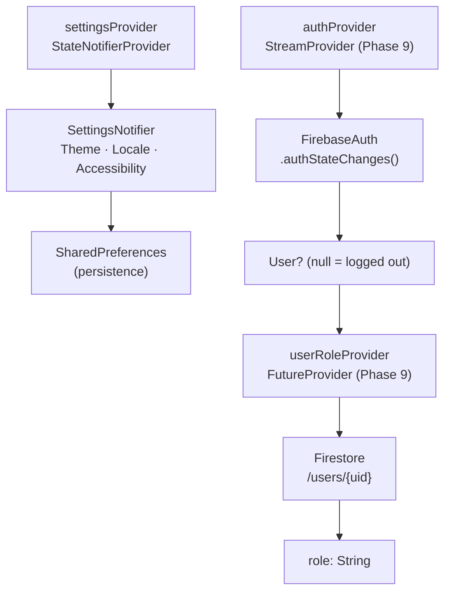
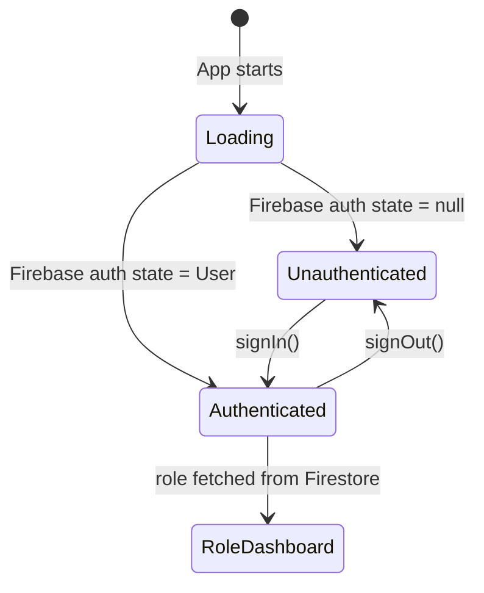

# Software Design Document (SDD)
## EasyLearn — AI-Based Learning Difficulty Screening & Explainable Intervention Support Platform

| Field | Detail |
|---|---|
| **Document Version** | 1.0 |
| **Status** | Final Draft |
| **Date** | October 2026 |
| **Prepared By** | Harshan PV |
| **Project Type** | Academic Final-Year Project |

---

## Table of Contents

1. [Introduction](#1-introduction)
2. [System Architecture](#2-system-architecture)
3. [Flutter App Design](#3-flutter-app-design)
4. [Backend Design](#4-backend-design)
5. [ML & XAI Pipeline Design](#5-ml--xai-pipeline-design)
6. [Firebase Integration Design](#6-firebase-integration-design)
7. [API Design](#7-api-design)
8. [Database Design](#8-database-design)
9. [State Management Design](#9-state-management-design)
10. [UI / Design System](#10-ui--design-system)
11. [Security Design](#11-security-design)
12. [Deployment Architecture](#12-deployment-architecture)

---

## 1. Introduction

### 1.1 Purpose
This Software Design Document (SDD) describes the architectural and detailed design of the **EasyLearn** platform. It serves as a blueprint for developers and is intended to map directly to the requirements defined in the SRS document.

### 1.2 Design Goals
- **Separation of concerns** — UI, business logic, data access, and ML inference are cleanly separated.
- **Modularity** — each feature is encapsulated in its own feature directory.
- **Testability** — services are injectable and independently testable.
- **Scalability** — the backend can switch from SQLite to PostgreSQL; Firebase abstracts auth/storage scale.

---

## 2. System Architecture

### 2.1 High-Level Architecture Diagram



### 2.2 Tier Overview

| Tier | Technology | Responsibility |
|---|---|---|
| **Presentation** | Flutter (Dart) | UI rendering, user interaction, state display |
| **State Management** | Riverpod | Reactive app state, auth stream, settings |
| **Service Layer (Flutter)** | Dart classes | Firebase Auth, Firestore, REST API calls |
| **API Gateway** | FastAPI (Python) | Route handling, request validation, auth middleware |
| **Business Logic** | FastAPI + Python | CRUD operations, recommendation matching |
| **ML Inference** | scikit-learn / XGBoost | Predict risk level from questionnaire features |
| **XAI** | SHAP | Compute feature-level explanation values |
| **Identity** | Firebase Auth | Token issuance, session management |
| **User Data** | Firestore | User documents with role field |
| **Operational Data** | SQLite (dev) / PostgreSQL (prod) | Students, screenings, interventions |
| **File Storage** | Firebase Storage | Document and report uploads |

---

## 3. Flutter App Design

### 3.1 Directory Structure

```
flutter_app/lib/
├── main.dart                        # App entry point, Firebase init, ProviderScope
├── core/
│   ├── theme/
│   │   └── app_theme.dart           # Monochrome HIG design tokens & ThemeData
│   └── config/
│       └── app_theme.dart           # Theme configuration alias
├── features/
│   ├── auth/
│   │   └── screens/
│   │       └── login_screen.dart    # Email/Password + Google Sign-In UI
│   ├── parent/
│   │   └── screens/
│   │       └── parent_dashboard.dart
│   ├── teacher/
│   │   └── screens/
│   │       └── teacher_dashboard.dart
│   ├── student/
│   │   └── screens/
│   │       └── student_dashboard.dart
│   ├── admin/
│   │   └── screens/
│   │       └── admin_dashboard.dart
│   ├── screening/
│   │   └── screens/
│   │       ├── screening_questionnaire_screen.dart
│   │       └── screening_result_screen.dart
│   └── settings/
│       └── screens/
│           └── settings_screen.dart
├── providers/
│   ├── settings_provider.dart       # Theme, locale, accessibility state
│   └── auth_provider.dart           # (Phase 9) Firebase auth stream provider
├── services/
│   ├── firebase_auth_service.dart   # (Phase 9) Firebase sign-in/out, ID token
│   ├── auth_service.dart            # Token storage (legacy → Firebase adapter)
│   ├── api_service.dart             # Generic HTTP client with Bearer token
│   ├── api_config.dart              # Base URL and timeout constants
│   ├── user_service.dart            # /api/v1/users CRUD
│   ├── student_service.dart         # /api/v1/students CRUD
│   ├── screening_service.dart       # /api/v1/screenings + predict
│   └── intervention_service.dart    # /api/v1/interventions + recommend
├── shared/                          # Shared widgets/utilities
└── localization/
    └── app_localizations.dart       # Generated l10n delegate
```

### 3.2 Navigation & Routing



### 3.3 Key Screen Designs

#### 3.3.1 Login Screen (`login_screen.dart`)
- Role selector dropdown (Parent / Teacher / Student / Admin).
- Email and password text fields in a monochrome inset card.
- Google Sign-In button (Phase 9).
- `Sign In` CupertinoButton with rounded pill shape.
- Dev bypass: master email → super-admin role switcher.

#### 3.3.2 Screening Questionnaire Screen
- 6 segmented rating bars (1–5), one per domain.
- Domain labels: Reading, Writing, Memory, Attention, Math, Social.
- Progress indicator at top.
- Submit button triggers `POST /api/v1/screenings/predict`.

#### 3.3.3 Screening Result Screen
- **Hero Risk Card**: color-coded by risk tier (Mild=amber, Moderate=orange, Elevated=red, None=green).
- **Diverging SHAP Bar Chart**: horizontal bars extending left (negative) and right (positive) for each feature.
- **Probability Gauge**: visual probability score (0–100%).
- **Clinical Narrative**: auto-generated text paragraph.
- **Intervention Cards**: top 3 recommendations with category icon, title, and duration.

---

## 4. Backend Design

### 4.1 Directory Structure

```
backend/
├── app/
│   ├── main.py              # FastAPI app setup, CORS, router registration
│   ├── database.py          # SQLAlchemy engine, session factory
│   ├── auth.py              # Firebase Admin SDK token verification
│   ├── models/
│   │   ├── user.py          # User ORM model
│   │   ├── student.py       # Student ORM model
│   │   ├── screening.py     # Screening ORM model
│   │   └── intervention.py  # Intervention ORM model
│   ├── schemas/             # Pydantic request/response schemas
│   └── api/
│       ├── auth.py          # POST /api/v1/auth/login, GET /api/v1/auth/me
│       ├── users.py         # CRUD /api/v1/users
│       ├── students.py      # CRUD /api/v1/students
│       ├── screenings.py    # CRUD + predict /api/v1/screenings
│       └── interventions.py # CRUD + recommend /api/v1/interventions
├── ml/
│   ├── train_model.py       # Model training script (WALS dataset)
│   ├── predictor.py         # ScreeningPredictor class (inference + SHAP)
│   └── models/              # Serialized model artifacts (.joblib files)
├── tests/
│   ├── test_api.py          # API endpoint tests
│   └── test_predictor.py    # ML predictor unit tests
├── seed_interventions.py    # DB seed script (13 sample interventions)
├── init_db.py               # Database initialization script
└── requirements.txt
```

### 4.2 Middleware & Request Lifecycle



### 4.3 FastAPI Application Setup (`main.py`)
- CORS middleware enabled (restrict origins in production).
- Routers registered: `/api/v1/auth`, `/api/v1/users`, `/api/v1/students`, `/api/v1/screenings`, `/api/v1/interventions`.
- Global exception handlers for `HTTPException` and unhandled errors.

---

## 5. ML & XAI Pipeline Design

### 5.1 Training Pipeline (`ml/train_model.py`)



**Feature Importance (from trained model):**
- writing_difficulty: 39.7%
- math_difficulty: 28.8%
- reading_difficulty: 10.1%
- attention_difficulty, memory_difficulty, social_difficulty: remaining

### 5.2 Inference Pipeline (`ml/predictor.py`)



**`ScreeningPredictor` class:**

| Method | Description |
|---|---|
| `predict(features)` | Main prediction method → (risk_level, probability, shap_dict) |
| `_prepare_input(features)` | Builds DataFrame with all required columns, fills defaults |
| `get_top_features(shap_values, top_n)` | Returns top-N feature names by absolute SHAP magnitude |
| `get_class_probabilities(features)` | Returns probability for all 4 risk classes |

**Risk Level Mapping:**

| Code | Label | Color Token |
|---|---|---|
| 0 | None | Green |
| 1 | Mild | Amber |
| 2 | Moderate | Orange |
| 3 | Elevated | Red |

### 5.3 Recommendation Engine



---

## 6. Firebase Integration Design

### 6.1 Firebase Services Used

| Service | Purpose | Flutter Plugin |
|---|---|---|
| Firebase Authentication | User sign-in (Email/Password, Google) | `firebase_auth` |
| Cloud Firestore | User role persistence | `cloud_firestore` |
| Firebase Storage | Report & document uploads | `firebase_storage` |

### 6.2 Firestore Data Model

```
/users/{firebaseUID}           ← Document per authenticated user
  ├── email: String
  ├── displayName: String
  ├── role: "parent" | "teacher" | "student" | "admin"
  ├── createdAt: Timestamp
  └── photoURL: String (nullable)
```

### 6.3 Authentication Flow



### 6.4 Firebase Auth Service (`firebase_auth_service.dart`)

| Method | Description |
|---|---|
| `signInWithEmail(email, password)` | Email/Password sign-in |
| `signInWithGoogle()` | Google OAuth sign-in |
| `signOut()` | Sign out from Firebase |
| `getIdToken()` | Retrieve current user's ID token for API calls |
| `getCurrentUser()` | Get `FirebaseUser` object |
| `authStateChanges()` | Stream of auth state changes |

### 6.5 Backend Token Verification (`app/auth.py`)

```python
# Pseudocode
import firebase_admin
from firebase_admin import auth as firebase_auth

def verify_firebase_token(token: str) -> dict:
    decoded = firebase_auth.verify_id_token(token)
    return decoded  # {uid, email, ...}

def get_current_user(token = Depends(oauth2_scheme)) -> dict:
    return verify_firebase_token(token)
```

---

## 7. API Design

### 7.1 Base URL
```
Development (emulator): http://10.0.2.2:8000
Development (device):   http://<machine-ip>:8000
Production:             https://<your-domain>
```

### 7.2 Authentication Header
```
Authorization: Bearer <Firebase ID Token>
Content-Type: application/json
```

### 7.3 Endpoint Catalogue

#### Auth (`/api/v1/auth`)

| Method | Path | Auth | Description |
|---|---|---|---|
| POST | `/login` | No | Verify Firebase token, return user role |
| GET | `/me` | Yes | Return current authenticated user info |

#### Users (`/api/v1/users`)

| Method | Path | Auth | Description |
|---|---|---|---|
| POST | `/` | Yes (Admin) | Create user |
| GET | `/` | Yes (Admin) | List all users |
| GET | `/{user_id}` | Yes | Get user by ID |
| PUT | `/{user_id}` | Yes (Admin) | Update user |
| DELETE | `/{user_id}` | Yes (Admin) | Delete user |

#### Students (`/api/v1/students`)

| Method | Path | Auth | Description |
|---|---|---|---|
| POST | `/` | Yes | Create student profile |
| GET | `/` | Yes | List all students |
| GET | `/{student_id}` | Yes | Get by internal ID |
| GET | `/by-student-id/{ext_id}` | Yes | Get by external student ID |
| PUT | `/{student_id}` | Yes | Update student |
| DELETE | `/{student_id}` | Yes | Delete student |

#### Screenings (`/api/v1/screenings`)

| Method | Path | Auth | Description |
|---|---|---|---|
| POST | `/` | Yes | Create screening record |
| POST | `/predict` | Yes | Submit questionnaire → ML prediction + SHAP |
| GET | `/` | Yes | List all screenings |
| GET | `/{screening_id}` | Yes | Get screening by ID |
| GET | `/student/{student_id}` | Yes | Get all screenings for a student |

#### Interventions (`/api/v1/interventions`)

| Method | Path | Auth | Description |
|---|---|---|---|
| POST | `/` | Yes (Admin) | Create intervention |
| GET | `/` | Yes | List interventions (optional category filter) |
| GET | `/{id}` | Yes | Get intervention by ID |
| PUT | `/{id}` | Yes (Admin) | Update intervention |
| DELETE | `/{id}` | Yes (Admin) | Delete intervention |
| POST | `/recommend` | Yes | Get personalized recommendations |

### 7.4 Key Request/Response Schemas

#### `POST /api/v1/screenings/predict` — Request
```json
{
  "student_id": "STU001",
  "features": {
    "reading_difficulty": 4,
    "writing_difficulty": 3,
    "memory_difficulty": 2,
    "attention_difficulty": 4,
    "math_difficulty": 3,
    "social_difficulty": 2
  }
}
```

#### `POST /api/v1/screenings/predict` — Response
```json
{
  "risk_level": "Elevated",
  "probability": 0.87,
  "shap_values": {
    "reading_difficulty": 0.32,
    "writing_difficulty": 0.51,
    "memory_difficulty": -0.12,
    "attention_difficulty": 0.28,
    "math_difficulty": 0.44,
    "social_difficulty": -0.08
  },
  "top_features": ["writing_difficulty", "math_difficulty", "attention_difficulty"],
  "class_probabilities": {
    "None": 0.02,
    "Mild": 0.05,
    "Moderate": 0.06,
    "Elevated": 0.87
  }
}
```

#### `POST /api/v1/interventions/recommend` — Request
```json
{
  "student_age": 8,
  "student_grade": "3",
  "top_features": ["writing_difficulty", "attention_difficulty"],
  "risk_level": "Elevated"
}
```

---

## 8. Database Design

### 8.1 Entity-Relationship Diagram



---

## 9. State Management Design

### 9.1 Riverpod Provider Architecture



### 9.2 Settings State (`SettingsState`)

| Field | Type | Default | Persistence |
|---|---|---|---|
| `themeMode` | `ThemeMode` | `light` | SharedPreferences |
| `locale` | `Locale` | `en` | SharedPreferences |
| `textSizeMultiplier` | `double` | `1.0` | SharedPreferences |
| `highContrast` | `bool` | `false` | SharedPreferences |
| `reduceMotion` | `bool` | `false` | SharedPreferences |
| `loggedInRole` | `String?` | `null` | SharedPreferences |

### 9.3 Auth State Flow (Phase 9)



---

## 10. UI / Design System

### 10.1 Monochrome HIG Design Tokens

| Token | Light Value | Dark Value | Usage |
|---|---|---|---|
| Background | `#FFFFFF` | `#0A0A0A` | Page/scaffold background |
| Surface | `#F7F7F9` | `#1C1C1E` | Cards, input containers |
| Foreground | `#0A0A0A` | `#FFFFFF` | Primary text, icons |
| Hairline | `#E5E5EA` | `#2C2C2E` | Borders (0.5px) |
| Ash Gray | `#8E8E93` | `#8E8E93` | Muted secondary text |
| Slate Gray | `#A1A1A6` | `#636366` | Subtle/disabled text |

### 10.2 Typography Scale

| Style | Font | Weight | Size | Tracking |
|---|---|---|---|---|
| Brand / H1 | System / Manrope | 800 | 34px | -0.8 |
| Section Header | System | 700 | 20px | -0.4 |
| Body | System | 400 | 15px | 0 |
| Caption | System | 600 | 11–13px | 0 |

### 10.3 Component Inventory

| Component | Description |
|---|---|
| Inset Card | Rounded (r=22) surface card with 0.5px hairline border |
| Pill Button | Full-width, border-radius 9999, inverted foreground/background |
| Segmented Rating Bar | 5-segment horizontal bar, tap to select score |
| Diverging SHAP Bar | Horizontal bar chart, positive = right, negative = left |
| Risk Hero Card | Full-width card, background color mapped to risk tier |
| CupertinoActivityIndicator | Loading state for async operations |
| Role Dropdown | Embedded in inset card with chevron icon |

### 10.4 Localization Architecture

```
flutter_app/lib/localization/
└── l10n/
    ├── app_en.arb     # English strings
    ├── app_ml.arb     # Malayalam strings
    └── app_hi.arb     # Hindi strings
```
Generated via `flutter gen-l10n` → `AppLocalizations` class.

---

## 11. Security Design

### 11.1 Authentication Security

| Layer | Mechanism |
|---|---|
| Token issuance | Firebase Auth (RS256-signed JWTs) |
| Token verification | Firebase Admin SDK (`verify_id_token`) |
| Token lifetime | 1 hour (auto-refreshed by Firebase SDK) |
| Logout | `FirebaseAuth.signOut()` + local state clear |

### 11.2 API Security

- All protected endpoints use `Depends(get_current_user)` — a FastAPI dependency that verifies the Firebase token.
- 401 Unauthorized returned if token is missing, expired, or invalid.
- CORS restricted to known origins in production.
- Rate limiting recommended in production (not in scope for Phase 9).

### 11.3 Firestore Security Rules (Recommended)
```javascript
rules_version = '2';
service cloud.firestore {
  match /databases/{database}/documents {
    match /users/{userId} {
      allow read, write: if request.auth != null && request.auth.uid == userId;
    }
  }
}
```

### 11.4 Data Privacy
- No PII stored in ML model inputs.
- Student data is linked to parent Firebase UID.
- SHAP explanations are stored as JSON blobs, not raw model weights.

---

## 12. Deployment Architecture

### 12.1 Development Environment

```
Developer Machine
├── flutter_app/         → flutter run -d <device>
├── backend/             → uvicorn app.main:app --reload --port 8000
└── Firebase Console     → Auth + Firestore (Spark free tier)
```

### 12.2 Production Deployment (Recommended)

```
┌─────────────────────┐     ┌─────────────────────────┐
│  Android APK/AAB    │     │   FastAPI on Cloud Run   │
│  (Play Store)       │────▶│   or Railway / Render    │
└─────────────────────┘     │   (Free tier available)  │
                            └──────────┬──────────────┘
                                       │
                          ┌────────────▼─────────────┐
                          │   Firebase (Spark tier)   │
                          │  Auth · Firestore · Store │
                          └──────────────────────────┘
```

### 12.3 CI/CD Recommendations
- `flutter test` + `flutter analyze` on every PR.
- `pytest backend/tests/` on every PR.
- Auto-deploy backend to Cloud Run on merge to `main`.

---

*End of SDD — EasyLearn v1.0*
